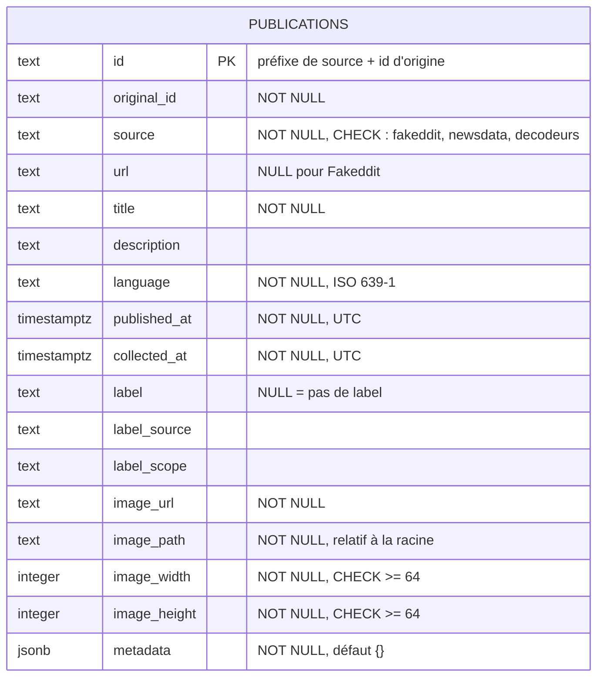

# Modèle de données : du schéma conceptuel au schéma physique

Ce document explique pourquoi le **schéma conceptuel** (`docs/schema_conceptuel.mmd`) compte 5 entités, alors que l'**implémentation PostgreSQL** (`sql/01_schema.sql`) repose sur une seule table.

Les deux schémas n'ont pas le même rôle :

| Schéma | Question | Ce qu'il décrit |
|---|---|---|
| **Conceptuel** | *Que représentent les données ?* | les entités du domaine et leurs relations, y compris celles qui sont **possibles** (une publication pourrait recevoir plusieurs labels) |
| **Physique** | *Comment les ranger pour les besoins actuels ?* | les tables, les types et les contraintes, dimensionnés pour les **données réellement collectées** |

---

## 1. Schéma conceptuel (rappel)

5 entités : **Source**, **Média**, **Publication**, **Image**, **Label**.

| Relation | Cardinalité conceptuelle |
|---|---|
| Source → Publication | une source fournit plusieurs publications (1–N) |
| Média → Publication | un média édite plusieurs publications ; une publication a 0 ou 1 média (0..1–N) |
| Publication → Image | exactement une image par publication (1–1) |
| Publication → Label | 0, 1 ou plusieurs labels par publication (1–0..N) |

---

## 2. Schéma physique : une table `publications`

---

## 3. Correspondance entité par entité

| Entité conceptuelle | Dans le schéma physique | Justification |
|---|---|---|
| **Publication** | la table `publications` | entité centrale |
| **Image** | colonnes `image_url`, `image_path`, `image_width`, `image_height` | relation **1–1** : une table séparée imposerait une jointure à chaque requête sans rien apporter. Les fichiers restent dans `data/images/` ; la base stocke leur chemin |
| **Label** | colonnes `label`, `label_source`, `label_scope` (nullables) | conceptuellement 0..N, mais **dans les données réelles, 0 ou 1** label par publication (1 pour Fakeddit, 0 pour les deux autres sources) |
| **Source** | colonne `source` + contrainte `CHECK` | 3 sources aux caractéristiques fixes, documentées dans le rapport d'exploration. Le `CHECK` apporte la même intégrité qu'une clé étrangère vers une table `sources` |
| **Média** | dans `metadata` (`source_name`, `source_url`, `source_priority`) | ne concerne que NewsData.io : une table pour une seule source multiplierait les tables sans besoin |

**Champs propres à chaque source, dans `metadata` (JSONB) :**

| Source | Champs |
|---|---|
| Les Décodeurs | `image_caption`, `image_credit` |
| Fakeddit | `author_hash` (pseudonymisé), `domain`, `num_comments`, `score`, `subreddit`, `upvote_ratio` |
| NewsData.io | `category`, `country`, `source_name`, `source_priority`, `source_url` |

Règle de chargement : toute clé qui n'est pas une colonne va dans `metadata`. Un nouveau champ ajouté par une source est conservé sans modifier le code.

---

## 4. Pourquoi une table plutôt que deux (`sources` + `publications`)

| | 2 tables | 1 table (retenue) |
|---|---|---|
| Avantages | pas de redondance des caractéristiques de source ; clé étrangère ; caractéristiques des sources interrogeables en SQL | pas de jointure ; chargement plus simple ; intégrité obtenue par `CHECK` |

La contrainte `CHECK` donne la même intégrité que la clé étrangère. Le seul avantage propre aux deux tables serait de disposer des caractéristiques des sources dans la base pour les indicateurs de suivi, qui ne sont pas encore définis. **On ne construit pas de structure pour un besoin non défini.**

---

## 5. Intégrité garantie par la base

| Famille | Mise en œuvre |
|---|---|
| Intégrité d'entité | `PRIMARY KEY (id)` |
| Intégrité de domaine | types (`TIMESTAMPTZ`, `INTEGER`, `JSONB`), `NOT NULL` sur les champs obligatoires, `CHECK` sur `source` et sur les dimensions d'image |
| Intégrité référentielle | non utilisée (une seule table) ; le `CHECK` sur `source` en tient lieu |

Ces contraintes doublent les contrôles de `transform.py` (**défense en profondeur**) : la base refuse une donnée invalide quel que soit le programme qui l'envoie. Elles sont vérifiées par `tests/test_load.py`.

---

## 6. Évolutions possibles, sans migration lourde

| Besoin futur | Évolution |
|---|---|
| Un indicateur a besoin des caractéristiques des sources | créer une table `sources` (3 lignes) et ajouter une clé étrangère sur la colonne `source`, qui existe déjà |
| Une publication reçoit un second label (verdict d'un fact-checker) | créer une table `labels` (`publication_id`, `label`, `label_source`, `label_scope`) et y migrer les colonnes de label |
| Un champ de `metadata` est souvent interrogé | le promouvoir en colonne typée, ou l'indexer |

Le schéma conceptuel reste la référence de ces évolutions : il décrit déjà les entités qui deviendraient des tables.
